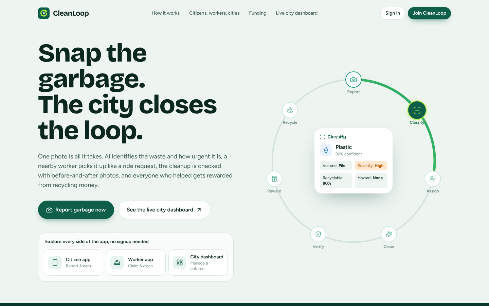
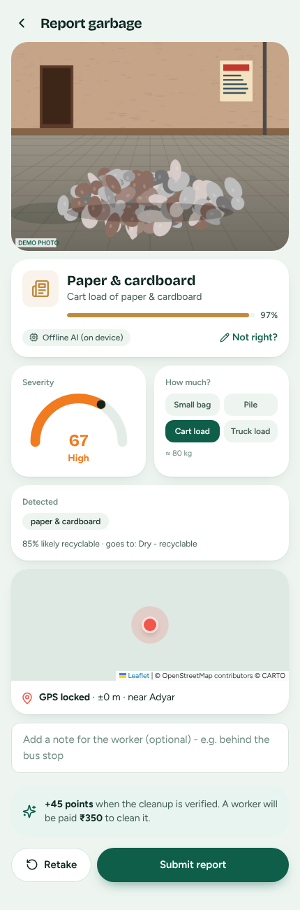
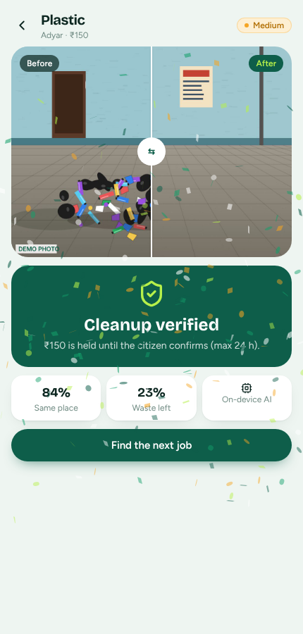
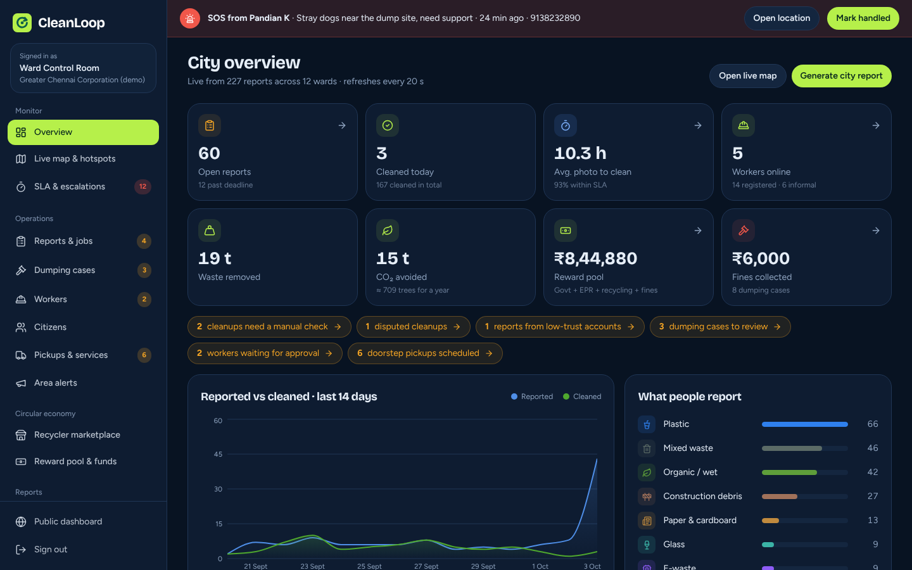

# CleanLoop

**Snap the garbage. The city closes the loop.**

CleanLoop is an AI-powered civic waste platform with three connected apps:

- **Citizens** report garbage or illegal dumping with one photo. On-device AI identifies the waste type, volume, severity and hazards. Citizens earn points, badges and cash rewards.
- **Workers** (municipal staff, gig workers and informal waste pickers) see nearby cleanup jobs Rapido-style, with the pay shown upfront. They check in at the spot, take before/after photos, and AI verifies the cleanup before they are paid.
- **The city (admin)** sees a live heatmap with predicted hotspots, SLA timers that auto-escalate ignored complaints, reviews dumping evidence and issues fines, sells sorted waste to recyclers, and tracks every rupee in the reward pool.

Everything works **offline and without any API keys**. Cloud AI (Gemini) and real payment/SMS/registry services are optional plug-ins.



| Citizen: AI report | Worker: verified cleanup | Admin: city overview |
|---|---|---|
|  |  |  |

More screens are in `docs/screenshots/`.

---

## 1. Run it on your computer (2 minutes)

1. Install **Node.js** (the LTS version) from <https://nodejs.org>. Just click through the installer.
2. Unzip this folder anywhere.
3. Start it:
   - **Windows:** double-click **`start.bat`**
   - **Mac / Linux:** open a terminal in this folder and run **`./start.sh`** (or `bash start.sh`)

Your browser opens **http://localhost:8080** automatically. That's it.

> The zip already contains the built app and the server package, so no internet is needed to start it.
> To stop the app, close the window or press `Ctrl + C`.

### Demo accounts

On the home page or the sign-in page, tap a demo account. Or sign in manually:

| Role | Email | Password |
|---|---|---|
| Citizen (Kavya Sundar) | `citizen@cleanloop.in` | `demo123` |
| Worker (Murugan Selvaraj) | `worker@cleanloop.in` | `demo123` |
| Admin (Ward Control Room) | `admin@cleanloop.in` | `admin123` |

The app ships with realistic demo data for 12 Chennai wards: about 220 reports, 47 citizens, 14 workers, dumping cases, drives, pickups, recycler sales and a funded reward pool.

**On a laptop without a camera:** the camera screen has two extra buttons in demo mode, **Upload** (use any photo) and **Demo photo** (generates a street scene marked "DEMO PHOTO"). Workers also get **"Demo: simulate arriving at the spot"**, so the whole flow can be shown from one laptop.

---

## 2. A 5-minute demo for judges

1. **Landing page** – the loop animation explains the idea: Report → Classify → Assign → Clean → Verify → Reward → Recycle.
2. **Citizen app** → tap the camera button → **Demo photo** (or a real photo). Watch the AI scan, then show the result: waste type, severity gauge, volume, hazard warning, duplicate check, points and worker pay. Submit.
3. **Citizen app** → home shows "spots you reported were cleaned" → open it → drag the before/after slider → **Yes, it's clean** → rate and tip the worker. The worker's held payment is released.
4. **Report dumping** → take a photo → faces are blurred on the phone → enter a vehicle number → send.
5. **Worker app** → go online → **swipe to claim** a job → simulate arrival → before photo → after photo → AI verifies → payout held until the citizen confirms. Show **Route** (optimised order) and **Earnings**, and hold the red **SOS** button.
6. **Admin dashboard** → overview KPIs and live activity → **Live map** (heatmap + predicted hotspots with suggested actions) → **Reports** (open a "Needs check" cleanup, compare photos, approve) → **Dumping cases** (look up the vehicle, issue a fine, mark it paid – the reporter gets 20%) → **SLA & escalations** → **Area alerts** (send to the corporation) → **Recycler marketplace** (list stock, accept a bid – money goes to the reward pool) → **Survekshan report** (print to PDF).
7. **Public dashboard** – ward cleanliness map and ranking anyone can see.

Before presenting, reset everything with **Admin → Settings & AI → Reset demo data**.

---

## 3. Test on your phone (needs an https link)

Phones only allow the camera and GPS on **https** websites. The easiest way is a free deploy on Render:

1. Create a free account on <https://github.com>, install **GitHub Desktop** (<https://desktop.github.com>), then **File → Add local repository** → pick this folder → **create a repository** → **Publish repository**. (The included `.gitignore` already skips `node_modules` and your `.env`.)
2. Create a free account on <https://render.com> and connect your GitHub.
3. In Render click **New + → Blueprint**, pick your repository and click **Apply**. Render reads `render.yaml` and builds it.
4. After a few minutes you get a link like `https://cleanloop-xxxx.onrender.com`. Open it on your phone. In Chrome you can choose **Add to Home screen** to install it like an app.

Notes:
- The free Render plan sleeps after 15 minutes without visits (the first visit then takes about 30 seconds) and resets the demo data on every restart. That's fine for demos.
- Other hosts work too: anything that runs `node server/index.js` (Railway, a VPS), or the included `Dockerfile`.
- For a quick test without deploying, you can run a tunnel such as `npx localtunnel --port 8080` or `cloudflared tunnel --url http://localhost:8080` while the app runs, and open the https link it prints.

---

## 4. Turn on Gemini cloud AI (optional, free)

The on-device model identifies the **material** (plastic, paper, cardboard, glass, metal, trash). Gemini adds richer analysis: severity, volume, hazards, the items it sees, and a stronger before/after cleanup check.

1. Get a free key at <https://aistudio.google.com/apikey>.
2. Copy `.env.example` to a new file named `.env` (in the same folder as `start.bat`).
3. Put your key after `GEMINI_API_KEY=` and save.
4. Restart the app. The terminal shows `AI: offline model in the browser + gemini`, and **Admin → Settings & AI** shows it as active.

If Gemini is slow or fails, the app automatically falls back to the on-device result, so the demo never breaks. On Render, add `GEMINI_API_KEY` under **Environment**.

---

## 5. Improve the AI model with your own photos

The included model was trained on the open **TrashNet** dataset (2,527 photos) with MobileNet transfer learning: **88.3% accuracy** on photos it never saw during training. Street photos from Indian cities will make it much better, and you can add new categories.

**Option A – Google Colab (no setup, free GPU):**
1. Open <https://colab.research.google.com> → **File → Upload notebook** → pick `ml/CleanLoop_Train_Model.ipynb`.
2. **Runtime → Change runtime type → T4 GPU**, then **Runtime → Run all**.
3. In step 3 you can upload a zip of your own photos, one folder per type (`organic/`, `ewaste/`, `medical/`, `construction/`, `plastic/` …, at least ~80 photos each).
4. It downloads `cleanloop_model.zip`. Unzip it into **both** `client/public/models/waste/` and `client/dist/models/waste/`, restart the app, refresh the page.

**Option B – on your computer (needs Python 3.10+):**
```bash
pip install tensorflow pillow h5py
python ml/download_dataset.py      # TrashNet into ml/dataset
# add your own folders/photos inside ml/dataset/
python ml/train.py                 # trains and installs the new model
```
`train.py` writes the model straight into the app (both folders). New category names are mapped onto the app's waste types automatically (`organic`, `food`, `ewaste`, `battery`, `medical`, `debris`, …).

---

## 6. Connect real services (optional)

Each service works in **simulated** mode until you set its URL in `.env`. The app sends a JSON `POST` to the URL; adapt `server/integrations.js` to your provider's exact API.

| Feature | `.env` setting | What it does |
|---|---|---|
| UPI payouts | `PAYOUT_WEBHOOK_URL` | Sends worker/citizen withdrawals to a payout gateway |
| SMS | `SMS_WEBHOOK_URL` | SOS and alert messages |
| Vehicle registry | `VEHICLE_LOOKUP_URL` | Owner lookup for dumping cases (authority access only) |
| Corporation alerts | `CORPORATION_WEBHOOK_URL` | Delivers area alerts by email/dashboard |

Set `DEMO_MODE=false` for real use. This turns off demo logins, demo photos, gallery uploads and simulated arrival, so photos must come from the live camera and check-ins must be within 60 m.

The database is a JSON file (`server/data/db.json`) so it runs anywhere with zero setup. To scale up, re-implement the functions in `server/db.js` on Postgres or MongoDB; nothing else needs to change.

---

## 7. How the hard problems are solved

| Problem | Solution in CleanLoop |
|---|---|
| Fake or reused photos | Camera-only capture with GPS and time stamped at capture; a perceptual image hash blocks re-used photos; points are paid only after a worker verifies the spot; a hidden **trust score** sends low-trust accounts to manual review; daily reward cap. |
| Duplicate reports | A report within 35 m of an open one (or with a similar photo) is merged as a **confirmation**, which raises its priority and gives a small reward. |
| Proof of cleanup | 60 m **geofenced check-in**; before and after photos at the spot; AI checks it is the **same place** and the **waste is gone**; payout is **held** until the citizen confirms (auto-release after 24 h); disputes go to the admin; random manual checks. |
| Fines from citizen photos | The app never fines anyone. Evidence goes to an officer who decides. Faces are blurred on the phone, number plates are visible only to the authority, reporters stay anonymous, and the reporter's 20% share is paid only after the fine is paid. False reports lower trust. |
| Funding rewards | Reward pool funded by city grants, brands' EPR obligations and CSR, recycler sales from the marketplace, and dumping fines – all tracked in the funds ledger. |

---

## 8. Useful commands

Run these in a terminal inside the project folder.

| Command | What it does |
|---|---|
| `npm start` | Start the app (same as the start scripts) |
| `npm test` | Run the automated end-to-end check (52 checks) while the app is running, then resets demo data |
| `npm run reset` | Recreate fresh demo data (stop the app first) |
| `npm run build` | Rebuild the web app after editing files in `client/src` (needs internet the first time) |
| `npm run dev:client` | Live-reload development mode for the web app on http://localhost:5173 (run `npm start` too) |

---

## 9. Project structure

```
cleanloop/
├── start.bat / start.sh      one-click launchers
├── server/                   Node.js + Express API (no database server needed)
│   ├── index.js              starts the app, serves the web app
│   ├── routes.js             all API endpoints (citizen, worker, admin, public)
│   ├── logic.js              points, badges, payouts, ward scores, hotspots, SLA escalation
│   ├── domain.js             categories, pay rates, CO₂ factors, wards, badges, rewards
│   ├── ai.js                 cloud AI plug-in (Gemini) with fallback
│   ├── integrations.js       payouts, SMS, vehicle lookup, corporation alerts (simulated)
│   ├── seed.js               demo data generator
│   ├── selftest.js           automated end-to-end check
│   └── db.js                 JSON-file database
├── client/                   React web app (installable PWA)
│   ├── src/pages/citizen     citizen app screens
│   ├── src/pages/worker      worker app screens
│   ├── src/pages/admin       admin dashboard
│   ├── src/lib/ai.js         on-device AI (TensorFlow.js): classify, volume, severity, cleanup check
│   ├── public/models/waste   the trained waste model
│   ├── public/models/face    face detector for privacy blurring
│   └── dist/                 the built app the server serves
├── ml/                       model training: train.py, Colab notebook, dataset downloader
├── Dockerfile, render.yaml   deployment
└── .env.example              optional settings
```

**Tech stack:** React 18, Vite, Tailwind CSS, Framer Motion, Leaflet maps (OpenStreetMap/CARTO tiles), Recharts, TensorFlow.js (MobileNet waste classifier + tiny face detector), Node.js + Express. Map tiles need an internet connection; everything else works offline.

---

## 10. Troubleshooting

- **"Node.js is not installed"** – install the LTS version from nodejs.org, then close and reopen the window.
- **The page doesn't open** – go to http://localhost:8080 yourself. If port 8080 is busy, the app picks the next free port and prints it.
- **Camera doesn't start on a phone** – the link must be https (see section 3). On a laptop, use **Upload** or **Demo photo**.
- **Location is wrong or missing** – allow location access. In demo mode, if you're outside Chennai the pin is placed in your ward and can be dragged.
- **Map is grey** – map tiles load from the internet; check your connection.
- **Start over** – Admin → Settings & AI → **Reset demo data**.
